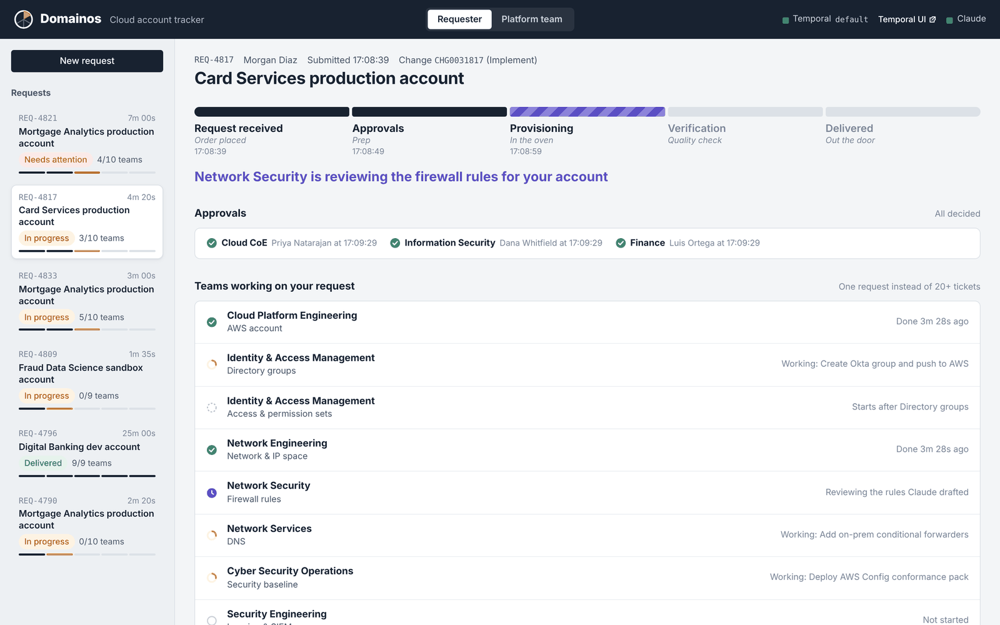
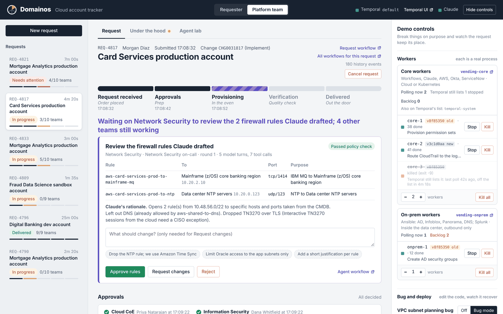
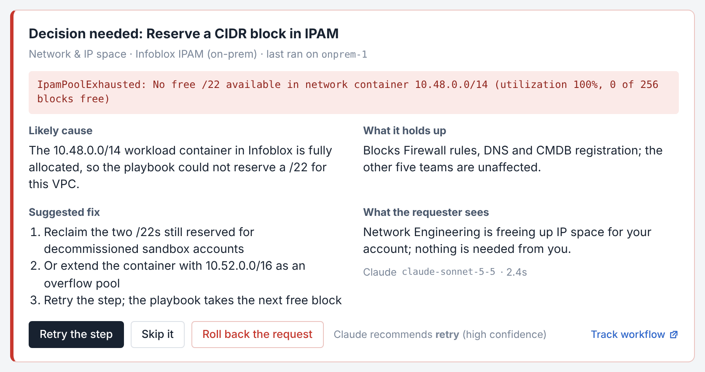
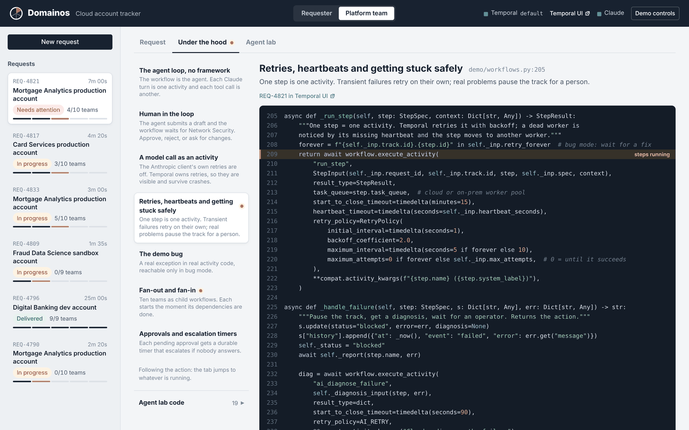
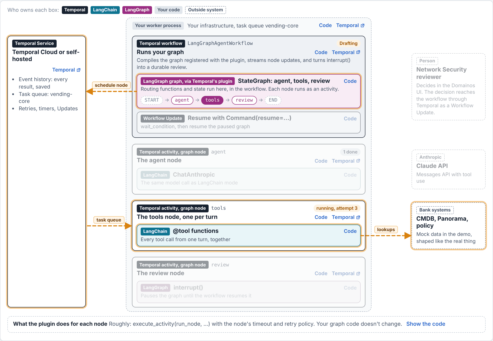

# Domainos

**A cloud account request tracker built on [Temporal](https://temporal.io), with Claude doing the reading, diagnosing and drafting.**

Someone asks for a new AWS account in plain English. Claude turns the request into a spec.
Temporal runs everything after that:

- the approvals;
- ten teams' provisioning work as child workflows, in parallel where it can and in order where it must;
- on-prem steps run by Ansible on workers inside the data center;
- a Claude agent that drafts firewall rules for a person to review;
- one change ticket for the whole request.

The person who asked gets a tracker that shows where the request is and who it's waiting on.
It works like a pizza tracker, but for cloud accounts.



Everything runs on your machine. Every outside system is a mock shaped like the real thing:
AWS, Active Directory, Infoblox, Panorama, ServiceNow, Okta and Splunk. You don't need access
to any of them, and you don't need an Anthropic API key. Without a key, Claude's jobs fall back
to simple rules. The company in the demo is fictional ("Example Bank"), and so are the people.

## What you can try

- **Place a request and follow it.** Watch approvals, then ten teams working at once, then
  verification and hand-off. Every box on screen links to the matching workflow in the Temporal UI.
- **Kill any worker, at any moment.** Workers are real processes. Kill one in the middle of a
  step, and another worker picks the step up at attempt 2. Nothing is lost.
- **Take the whole on-prem pool down.** On-prem steps wait on the server. Cloud steps keep
  going. Add a worker back and the backlog drains.
- **Break a system on purpose.** A transient failure retries on its own. A hard failure pauses
  that one team. Claude explains what went wrong, and you choose retry, skip or roll back.
- **Review an AI agent's work.** A Claude agent looks up systems in the CMDB, checks existing
  firewall rules, drafts least-privilege rules and checks them against policy. Then it waits,
  durably, for a person to approve, reject or ask for changes.
- **Fix a bug while a request waits.** Turn on bug mode and watch a step fail and retry.
  Comment out one line and save. The workers redeploy, and the request carries on from that step.
- **Read the code that's running.** The *Under the hood* tab shows the real source, with the
  line that's running right now highlighted.
- **Compare agent runtimes.** The *Agent lab* runs the same agent three ways: no framework,
  LangChain and LangGraph. It shows exactly where Temporal fits with each one.

## Contents

- [Prerequisites](#prerequisites)
- [Quick start](#quick-start)
- [A tour of the screen](#a-tour-of-the-screen)
- [Your first request](#your-first-request)
- [Scenarios to try](#scenarios-to-try)
- [The Under the hood tab](#the-under-the-hood-tab)
- [The Agent lab](#the-agent-lab)
- [How it works](#how-it-works)
- [Running it other ways](#running-it-other-ways)
- [Making it real](#making-it-real)
- [Customizing](#customizing)
- [Configuration reference](#configuration-reference)
- [Project layout](#project-layout)
- [Tests](#tests)
- [Troubleshooting](#troubleshooting)
- [License](#license)

## Prerequisites

| You need | Why | Check |
|---|---|---|
| **macOS or Linux** | The server starts and kills worker processes with Unix signals. On Windows, use [WSL 2](https://learn.microsoft.com/windows/wsl/install). | |
| **Python 3.11 or newer** | The app, its workers and the optional LangGraph plugin. | `python3 --version` |
| **Temporal CLI** | Runs a local Temporal server and the Temporal UI with one command. | `temporal --version` |
| **An Anthropic API key** (optional) | Lets Claude parse requests, brief approvers, diagnose failures and run the agent. Without a key, rules take over and everything still works. | [console.anthropic.com](https://console.anthropic.com) |
| **A browser** | The UI is a single page served by the app. | |

To install the Temporal CLI, use `brew install temporal` on macOS or Linux. You can also
download a build from the [Temporal CLI docs](https://docs.temporal.io/cli) and put
`temporal` on your `PATH`.

You'll need these ports free: **7233** (Temporal), **8233** (Temporal UI), **8800** (Domainos)
and, if you use the preview, **8801**.

## Quick start

**1. Get the code and install the dependencies.**

```bash
git clone https://github.com/temporal-sa/domainos-demo.git
cd domainos-demo
python3 -m venv .venv
source .venv/bin/activate
pip install -r requirements.txt
```

**2. Configure it (optional).**

```bash
cp .env.example .env
```

Open `.env` and set `ANTHROPIC_API_KEY` if you have one. Every other setting has a working
default for a local run. See the [configuration reference](#configuration-reference).

**3. Start Temporal** in its own terminal:

```bash
temporal server start-dev
```

That starts a Temporal server on `localhost:7233`, with the Temporal UI on
http://localhost:8233. The dev server keeps everything in memory. To keep your workflow
history between restarts, add `--db-filename domainos.db`.

**4. Start Domainos** in a second terminal, with the virtual environment active:

```bash
python -m demo.api.server
```

```
  Domainos UI: http://127.0.0.1:8800
  Temporal: localhost:7233 (default)  UI links: http://localhost:8233
```

The server also starts four workers as separate processes: two **core** workers and two
**on-prem** workers. You can kill, stop and add workers from the UI.

**5. Open http://127.0.0.1:8800.** The top bar should show a green dot next to *Temporal* and,
if you set a key, next to *Claude*. If Claude says *off (keyword rules)*, there's no key and
the rule-based fallbacks are in use.

> **Just want to see the UI?** `python dev/ui_preview.py` serves the real interface on canned
> data at http://127.0.0.1:8801. You don't need Temporal or workers for it. Buttons answer with a
> message but don't change anything. See [UI preview](#ui-preview-no-temporal-needed).

## A tour of the screen



- **Top bar.** The **Requester** and **Platform team** buttons switch between the two views.
  You'll also see the Temporal connection with a link to the Temporal UI, Claude's status, and
  a button that shows or hides the demo controls.
- **Left rail.** **New request** opens the request form. Under it is every request, with its
  status and how many teams have finished.
- **Middle, Platform team view.** There are three tabs:
  - **Request:** the selected request in full. You'll see its stage, approvals with Claude's
    briefing, the provisioning map with one box per team, step-level detail with live logs,
    and any decision waiting on you.
  - **Under the hood:** the code behind what's happening right now. See
    [the Under the hood tab](#the-under-the-hood-tab).
  - **Agent lab:** the firewall agent on three runtimes. See [the Agent lab](#the-agent-lab).
- **Middle, Requester view.** The tracker: five stages, a one-line status in plain language,
  and a row per team. There's no Temporal vocabulary anywhere on it.
- **Right, Demo controls** (Platform team view only). Use these to break things on purpose:
  - **Workers:** each pool with its live workers, backlog and a link to its task queue.
    You can **Stop**, **Kill**, add or remove workers, or **Kill all**.
  - **Bug and deploy:** bug mode and worker redeploys.
  - **Inject a failure:** one-shot failures and per-system flakiness.
  - **Approvals, Retries, Pace:** timers, retry settings and step duration for new requests.

## Your first request

This walkthrough takes a production request from start to finish in a few minutes.

1. **Place it.** Click **New request** and pick the **Prod with borrower data** preset (or
   write your own). Then click **Place request**. A new `AccountVendingWorkflow` starts, with
   the workflow ID `vend-req-NNNN`.

2. **Intake.** Claude reads the text and turns it into a spec. The spec includes the team,
   environment, data classification, cost center, owners and whether the account needs to
   reach the data center. Claude also states any assumptions it made. From the spec, the
   planner works out which teams and approvals the request needs, and one change request
   opens in the mock ServiceNow. Look for the change number on the Request tab.

3. **Approvals.** This request needs three approvals: **Cloud CoE**, **Information Security**
   (because the account holds confidential data) and **Finance** (because it's production).
   Claude writes a short briefing for the approvers, with a risk level and concerns. Click
   **Approve** on each one; you're acting as the named approver. Each approval is a Workflow
   Update, so the workflow validates the decision and records it before the button returns.
   - If you leave an approval alone, it escalates after a minute. The escalation runs on a
     durable timer, so it survives a worker restart.
   - To skip this step, set **Demo controls → Approvals → Auto-approve after** to 5s before
     placing the request.

4. **Provisioning.** Once all three approvals are in, the request fans out. Each team is a
   child workflow (`ProvisioningTrackWorkflow`), and each starts when the teams it depends on
   are done:
   - **AWS account** and **Directory groups** start right away.
   - **Network & IP space** waits for the account.
   - **Firewall rules** waits for the network.
   - The other teams follow their own dependencies.

   Click a box on the map to see that team's steps, which worker ran each one, attempt
   numbers and live logs. Steps marked *on-prem* run on the on-prem workers.

5. **The firewall agent.** When **Network & IP space** finishes, **Firewall rules** starts a
   Claude agent (`FirewallRuleAgentWorkflow`). Open that track to watch each model turn and
   tool call appear as it happens: CMDB lookups, existing-rule checks, a policy check. Then a
   review card appears with the following:
   - the drafted rules;
   - the policy result;
   - Claude's rationale, including what it left out. It drops TN3270 because that needs a
     CISO exception, and it skips DNS because an existing rule already allows it.

6. **Review.** Try **Request changes** first. Click a suggestion such as *Drop the NTP rule…*
   or type your own, then click **Request changes**. Your note goes back into the agent's
   conversation, and it drafts round 2. Then click **Approve rules**. The approved rules go to
   the Ansible playbook on an on-prem worker, which stages them on Panorama and commits.

7. **Verification and hand-off.** When every team is done, the workflow runs its checks.
   Claude writes a short "your account is ready" note, and the change request closes. The
   Request tab shows the outputs: account ID, VPC, CIDR, Okta group, change number and CMDB
   record.

8. **Look at it from the outside.** Switch to the **Requester** view to see the same request
   the way the requester sees it. Then follow any **Temporal** link:
   - **Request workflow** opens the parent workflow's event history.
   - **All workflows for this request** lists the parent, the ten team workflows and the agent.
   - Each team's **Track workflow** link opens that child workflow.

You can also query a running request from the Temporal CLI:

```bash
temporal workflow list --query "WorkflowType='AccountVendingWorkflow'"
temporal workflow query --workflow-id vend-req-NNNN --name get_state --output json
```

## Scenarios to try

Each scenario below says how to set it up, what to watch and what's going on. If a scenario
moves too fast to follow, set **Pace → Slow** in Demo controls. **Clear all injected
failures**, at the bottom of the controls, resets every injected failure.

### Kill a worker in the middle of a step

- **Try it.** Place a request. Approve it, or turn on auto-approve. While a long step such as
  *Create account in AWS Organizations* is running, find the worker running it under **Core
  workers** and click **Kill**. Kill sends SIGKILL, so the worker gets no chance to clean up.
- **Watch.** The step stays *running* for a few seconds. Then Temporal notices the missed
  heartbeat, the step moves to the other core worker, and its attempt count goes to 2. The
  killed worker shows how long Temporal will keep listing it (see
  [Troubleshooting](#troubleshooting)).
- **What's going on.** Every step is a Temporal activity with a heartbeat timeout
  (**Retries → Dead worker noticed in**, 8 seconds by default). Steps that had already
  finished are never run again; their results are in the workflow's history.

### Take the on-prem pool down

- **Try it.** Click **Kill all** under **On-prem workers**, then place a request with
  on-prem needs, such as **Prod with borrower data**.
- **Watch.** On-prem steps wait with *no worker yet*, and the pool's **Backlog** climbs. The
  on-prem steps are:
  - *Create AD security groups*
  - *Reserve a CIDR block in IPAM*
  - the Panorama steps
  - *Add on-prem conditional forwarders*
  - *Onboard account to Splunk*

  Cloud steps on the core pool keep going. Click **+** to add an on-prem worker, and the
  backlog drains in order.
- **What's going on.** There are two task queues: `vending-core` and `vending-onprem`. Work
  waits on the Temporal server until a worker for its queue asks for it. On-prem workers only
  make outbound connections to Temporal, so nothing has to reach into the data center.

### A failure that needs a person



- **Try it.** Under **Inject a failure**, click **Arm** next to **IPAM pool exhausted**, then
  place any request.
- **Watch.** *Reserve a CIDR block in IPAM* fails with a non-retryable error. The **Network &
  IP space** track pauses, and the request shows **Needs attention**. Claude reads the error
  and fills in four parts:
  - the likely cause;
  - what the failure holds up;
  - a suggested fix;
  - what the requester sees.

  Teams that don't depend on the network keep working. Then choose one of the three options:
  - **Retry the step.** The injected fault fires only once, so the retry succeeds and the
    request carries on.
  - **Skip it.** The track moves past the step.
  - **Roll back the request.** Every team's completed work is undone in reverse order, and
    the change request closes.
- **More of the same.** **Panorama commit lock** fails *Commit and push from Panorama*, after
  the firewall review. **AWS account quota reached** fails the very first step, and since
  every team depends on the account, it's the quickest way to see a full roll back.
- **What's going on.** A failed step pauses its track while the workflow waits for your
  decision. The decision arrives as a Workflow Update on that track's child workflow. While
  it waits, the paused track uses no compute.

### Failures that fix themselves

- **Try it.** Arm **Okta rate limiting** (three 429s) or **ServiceNow API outage** (four
  503s), then place a request. For random trouble, open **Flaky systems** and drag a system's
  slider up.
- **Watch.** The affected step's attempt count climbs, with the error and next retry time
  shown, until the call succeeds. No one has to act. The retries also show in the activity's
  details in the Temporal UI.
- **What's going on.** The retry policy is declared once on the activity. There are no retry
  loops in the step code.

### Crash the agent while it's thinking

- **Try it.** While the firewall agent is drafting, kill a core worker.
- **Watch.** The agent picks up at the turn it was on. Earlier turns and tool calls aren't
  repeated, so Claude isn't asked the same thing twice and the CMDB isn't queried twice.
- **What's going on.** Each model turn and each tool call is its own activity, and the
  workflow is the agent loop. A finished turn is in history, so a new worker replays it from
  history instead of running it again. Agent activities heartbeat while Claude is thinking,
  so a dead worker is noticed within seconds, not after the two-minute turn timeout.

### Approvals that wait, escalate or approve themselves

- **Escalate:** leave an approval pending. After the **Escalate if waiting** time (1 minute
  by default), it shows *Escalated to …*.
- **Auto-approve:** set **Auto-approve after** to 5s, 15s or 30s, and new requests approve
  themselves after that delay.
- **Policy:** the **Data science sandbox** preset gets its Cloud CoE approval automatically.
  The rule is in `config/catalog.yaml` (`auto_when: {environment: [sandbox]}`), not in code.
- All of these are durable timers on the Temporal server. Restart every worker, and the
  timers still fire on time.

### Reject, cancel and roll back

- **Reject an approval.** The request closes as *Rejected*, and nothing is provisioned.
- **Reject the agent's firewall draft.** The request rolls back: every team that finished
  has its work undone in reverse order.
- **Cancel request** (top right of the Request tab). This works at any point while the
  request is running, with the same clean-up.

### Fix a bug while the request waits

`demo/subnets.py` has one marked line:

```python
if bug_mode("vpc_subnets"): raise IndexError("list index out of range")  # DEMO-BUG
```

1. Under **Bug and deploy**, set **VPC subnet planning bug** to **Bug mode**. Then place a
   request; the **Data science sandbox** preset is quickest.
2. *Create VPC and subnets* fails with `IndexError` and keeps retrying every few seconds.
   Requests placed in bug mode retry this step until it succeeds, rather than giving up after
   the usual number of attempts. The **Under the hood** tab jumps to the bug line and
   highlights it in red.
3. Open `demo/subnets.py` in your editor, comment out the marked line and save.
4. With **Redeploy workers on save** on (the default), the server:
   - checks that the new code compiles;
   - starts new workers on it;
   - stops each old worker once its replacement is up.

   Each worker shows its code version, such as `v3c1d0aa`, so you can watch old and new side
   by side. If the new code doesn't start, the old workers keep running and the panel says why.
5. The next retry runs the fixed code, and the request continues from that step. Approvals,
   the AWS account and the AD groups are all untouched.
6. Uncomment the line to put the bug back for next time.

Python doesn't reload code inside a running process, so a fix always means new worker
processes, just as a real deploy would. If you'd rather deploy by hand, turn off **Redeploy
workers on save** and use **Deploy now**. Keep experiments like this in activity code.
Changing workflow code under running workflows needs
[versioning](https://docs.temporal.io/develop/python/versioning).

### Different requests, different plans

The four presets give four different plans from the same catalog:

| Preset | Approvals | Teams | Notes |
|---|---|---|---|
| Prod with borrower data | Cloud CoE, Information Security, Finance | 10 | Needs the data center, so it runs the firewall agent. |
| Card data, mainframe link | Cloud CoE, Information Security, Finance | 10 | PCI data is classified Restricted. Needs the mainframe. |
| Cloud-only dev service | Cloud CoE | 9 | No data center link, so there's no firewall track. |
| Data science sandbox | Cloud CoE (approved automatically) | 9 | The fastest way to a finished request. |

You can also write your own request. Change the environment, mention card data or customer
data, or ask for a link to a data center system, and watch how the plan changes.

## The Under the hood tab



This tab shows the code behind what you're looking at, read live from the source files:

- the agent loop;
- the human review wait;
- a model call as an activity;
- retries and heartbeats;
- the bug line;
- the fan-out;
- the approval timers.

The line that's running right now is highlighted. **Follow the action** is on by default, so
the tab jumps to whatever is happening in the selected request. Click any entry to pin it.
Each excerpt has a **What to notice** panel and a link to the matching workflow in the Temporal
UI.

Excerpts are marked in the source with `# [snippet:<id>]` … `# [/snippet]`, and their notes
live in `config/code_notes.yaml`. Edit either one, and the tab picks up the change within a
few seconds. Editing the notes doesn't trigger a worker redeploy.

## The Agent lab



Teams adding Temporal to an agent built with LangChain or LangGraph usually ask the same
questions:

- Does Temporal wrap the framework, or the other way round?
- Which one talks to the model, and which one runs the tools?
- When the model asks for a tool, how does that request get back to Temporal?

The Agent lab answers these by running the firewall agent from the main flow three ways.
Pick a runtime at the top: **No framework**, **LangChain** or **LangGraph**.

- **No framework.** The workflow is the agent loop. One activity calls the Anthropic API for
  each model turn, and one activity runs each tool call.
- **LangChain.** It's the same shape, with LangChain inside the activities: `ChatAnthropic`
  for the model and `@tool` functions for the tools. Temporal has no official LangChain
  plugin, so this is the wrapping you'd write yourself, and it's deliberately fine-grained.
  The note under the diagram links to the *coarse* alternative, the whole agent in one
  activity, and explains what it costs: a failure on turn 6 reruns turns 1 to 5, and there's
  nowhere to pause for a review.
- **LangGraph.** Temporal's
  [LangGraph plugin](https://docs.temporal.io/develop/python/integrations/langgraph) runs
  your graph inside the workflow, where routing and state live, and runs each node as an
  activity. The review node calls `interrupt()`, and the workflow resumes it with
  `Command(resume=...)` when a person decides. This plugin is in Public Preview.

For each runtime, the tab shows four things:

- **A diagram of what wraps what.** The Temporal Service is on the left and your worker
  process is in the middle: the workflow, plus one box for each kind of activity. Claude, the
  reviewer and the systems the agent uses are on the right. Every box is colored by who owns
  it: Temporal, LangChain, LangGraph, your code, or an outside system.
- **Follow one tool call.** Nine steps go from "the workflow asks for a model turn" through
  "Claude asks for a tool (it doesn't run it)" to "a person decides" and "if a worker dies".
  Each step highlights the boxes involved and draws the hop between them. While a run is
  going, the walkthrough follows it on its own. Click a step to take over, and click **Follow
  the run** to hand control back.
- **Code and Temporal links on every box.**
  - **Code** jumps to that piece on the Under the hood tab. It shows a short excerpt of the
    real file or, for things like "what the plugin does with each node", a clearly labeled
    Python illustration. **Back to Agent lab** brings you back.
  - **Temporal** opens that runtime's latest lab run.
- **Run it.** Pick a scenario, then click **Run on …** for one runtime, or **Run all three
  side by side**.

| Scenario | What happens |
|---|---|
| Happy path | The agent drafts rules for a production account that needs the Oracle loan database, mainframe MQ, DNS and NTP. Claude drops TN3270 (it needs a CISO exception) and skips DNS (already allowed). |
| Worker crash mid-run | When the third model turn starts, every core worker is killed. New ones start 3 seconds later, and only that turn runs again. |
| Flaky CMDB | 30% of CMDB lookups fail while the agent drafts. Without a framework or with LangChain, one tool call retries. With LangGraph, the whole tools node retries, with every lookup in it. |
| Claude rate-limited | The first two model calls get a 429. Temporal backs off and retries the turn. |

You can also crash workers yourself with **Crash core workers now**, or make the CMDB flaky
with **Fail 30%**, in the middle of any run.

Each run's card shows:

- its durable steps, one box per activity, with crash markers and retries;
- a scorecard: model calls, tool runs, anything repeated, and what a single coarse activity
  would have redone after the crash;
- its own **Approve**, **Request changes** and **Reject** buttons.

Below the cards, **Who does what** compares the three runtimes job by job.

> The **Worker crash** scenario and **Crash core workers now** kill the core workers that
> also run your requests. Any request in flight pauses for a few seconds and then carries on,
> which shows the same durability from another angle.

**Which runtime the main flow uses.** **New requests use**, at the bottom of the Run it panel,
picks the runtime for the firewall track in new requests. The default is *No framework*.

### Installing the framework runtimes

The diagrams and code links work without any extra packages. To *run* the LangChain and
LangGraph versions, install their packages and restart `python -m demo.api.server`:

```bash
pip install langchain-anthropic                                   # LangChain
pip install temporalio-langgraph langgraph langchain-anthropic    # LangGraph (Python 3.11+)
```

If a runtime's packages are missing, its **Run** button is disabled and the install command
appears next to it. Workers load a runtime only if its packages import, so a missing package
never stops the rest of the app. The LangGraph plugin is in Public Preview. If an import or API
name has moved, check the plugin's docs. After installing, run
`pytest tests/test_frameworks.py tests/test_workflows.py` to check both runtimes end to end.

All the words on this tab live in `config/agent_lab.yaml`: box text, the nine steps,
scenarios and the comparison table. The notes on its code excerpts are in
`config/code_notes.yaml`, under `section: lab`.

## How it works

```
                 ┌──────────── AccountVendingWorkflow (one per request) ────────────┐
 free text ──►   │ intake ─► approvals ─► provisioning DAG ─► verification ─► done  │
                 │  Claude    Updates +     child workflow       checks      Claude   │
                 │  spec      durable       per team             + ticket    hand-off │
                 │  + plan    timers                                                 │
                 └───────────────────────────────┬───────────────────────────────────┘
                                                 │ fan out / fan in
         ┌───────────────┬───────────────┬───────┴──────┬────────────────┬─────────┐
     AWS account   Directory groups   Network & IP   Firewall rules   Security   …  (10 teams)
     (core queue)  (AD via Ansible,   (IPAM on-prem, (Claude agent +   baseline
                    Okta in cloud)     VPC in AWS)    review, then
                                                      Panorama via
                                                      Ansible)
```

### Workflows

- **`AccountVendingWorkflow`, one per request.** It runs:
  - intake;
  - approvals, using Workflow Updates from the UI plus durable timers that escalate;
  - a dependency-driven fan-out of child workflows, one per team;
  - verification and hand-off.

  If a request is rejected, cancelled or rolled back, completed work is undone in reverse
  order, using the saga pattern.
- **`ProvisioningTrackWorkflow`, one per team.** It runs that team's steps in order.
  Transient errors retry with backoff. If a step fails for good, the track pauses, Claude
  diagnoses the failure, and an operator chooses retry, skip or roll back. That choice is a
  Workflow Update on the child workflow.
- **`FirewallRuleAgentWorkflow`.** This is the agent loop, with no framework. It works like
  this:
  - Each Claude turn is an activity (`agent_llm_turn`), with the Anthropic client's own
    retries turned off.
  - Each tool call is another activity (`agent_tool`). The tools are `lookup_cmdb`,
    `check_existing_rules` and `check_policy`. When the agent calls `submit_rules`, the loop
    ends.
  - The workflow then waits durably for Network Security to approve, reject or request
    changes. A change request goes back into the conversation, and the agent revises.
- **`LangChainAgentWorkflow` and `LangGraphAgentWorkflow`.** These are the same agent on the
  two frameworks. They use the same query and update as the plain agent, so the UI and the
  parent track don't care which runtime ran.

### Task queues and workers

| Pool | Task queue | Runs | Where it would live |
|---|---|---|---|
| core | `vending-core` | All workflows, Claude, AWS, Okta, ServiceNow | Cloud or Kubernetes |
| onprem | `vending-onprem` | Ansible against Active Directory, Infoblox, Panorama and Windows DNS; Splunk | Inside the data center, outbound connections only |

Each step in `config/catalog.yaml` names a system. Each system has a location, and the
location decides the task queue.

### Where Claude is used

| Job | Activity | Without an API key |
|---|---|---|
| Turn free text into a structured spec, with stated assumptions | `ai_parse_request` | Keyword rules |
| Brief approvers (risk level, concerns) | `ai_risk_review` | Rules |
| Diagnose a failed step and recommend retry, skip or roll back | `ai_diagnose_failure` | A playbook per error type |
| Write the "your account is ready" note | `ai_completion_summary` | A template |
| Draft firewall rules with tools, check them, revise on feedback | `agent_llm_turn`, `agent_tool` | A scripted agent that follows the same steps |

Each job runs as an activity with the client's own retries off, so Temporal owns retries. If
Claude stays unavailable through the last attempt, the activity returns the fallback instead of
failing the request.

The agent's systems (CMDB, Panorama, policy) are mock data in `demo/agents/firewall.py`,
shaped like the real thing. They include an Oracle loan database, a mainframe with MQ and
TN3270, and shared DNS and NTP.

### How the UI talks to Temporal

| Pattern | Used for | Example |
|---|---|---|
| **Query** | The workflow's own view, including steps that haven't started yet. Those aren't in history yet, so the Temporal UI can't show them. | `get_state`, `get_steps`, `get_agent` |
| **Update** | Changes that need validation and an answer. The validator rejects bad input before anything is written. | `decide_approval`, `resolve`, `review_draft`, `cancel_request` |
| **Describe** | Facts from the server: attempt numbers, last failure, last worker, next retry. These work with zero workers running. | Pending activities, task queue pollers |
| **Signal** | Child workflows reporting progress to the parent. | `track_progress` |

`demo/api/aggregator.py` combines these into one snapshot, and the UI polls it once a second.

## Running it other ways

### Without Claude

Leave `ANTHROPIC_API_KEY` empty, or set `DEMO_AI_DISABLED=true` to force the fallbacks even
with a key. Everything still runs, and the UI marks each Claude-written section with its
source: Claude, or the rule that stood in for it.

### Temporal Cloud or a self-hosted cluster

Set the connection in `.env`. With an API key:

```bash
TEMPORAL_ADDRESS=us-east-1.aws.api.temporal.io:7233
TEMPORAL_NAMESPACE=your-namespace.a1b2c
TEMPORAL_API_KEY=...
```

With mTLS:

```bash
TEMPORAL_ADDRESS=your-namespace.a1b2c.tmprl.cloud:7233
TEMPORAL_NAMESPACE=your-namespace.a1b2c
TEMPORAL_TLS_CERT=/path/to/client.pem
TEMPORAL_TLS_KEY=/path/to/client.key
# TEMPORAL_TLS_CA=/path/to/ca.pem      # self-hosted with a private CA
```

Links into the Temporal UI switch to `cloud.temporal.io` automatically for Cloud addresses.
Set `TEMPORAL_UI_URL` to point them somewhere else.

### Running workers yourself

By default, the app's server starts and manages its worker processes. To run them yourself,
for example as one Kubernetes Deployment per pool, set `DEMO_MANAGE_WORKERS=false` and start
workers anywhere that can reach Temporal:

```bash
python -m demo.worker --pool core   --identity core-1
python -m demo.worker --pool onprem --identity onprem-1
```

The Workers panel still shows what's polling each task queue, but the start, stop and kill
buttons go away.

### UI preview (no Temporal needed)

```bash
python dev/ui_preview.py                   # http://127.0.0.1:8801
python dev/ui_preview.py --no-frameworks   # the Agent lab as it looks without LangChain/LangGraph
```

The preview runs canned state through the same view code the real server uses. It includes
requests waiting on approvals, provisioning with a retry, blocked with a diagnosis, delivered,
and a simulated Agent lab run. It's handy for UI work and screenshots.

## Making it real

Every system starts in mock mode. Mocks return stable IDs for each request, so retries are
safe the same way well-built real calls are. The real connectors are written against each
system's API, but they **haven't been run against live systems**. Start with AWS in dry-run
mode.

1. **AWS.** In `config/connectors.yaml`:
   - Set the `aws_*` systems to `mode: real`.
   - Fill in the OU IDs, SCP IDs and Transit Gateway ID.
   - Keep `dry_run: true` for a first pass. Dry run logs every boto3 call it would make
     without making it.

   Then set `dry_run: false`. Rollback never closes AWS accounts unless you set
   `allow_destructive_compensation: true`.
2. **On-prem, with Ansible.** On the on-prem workers, install `ansible-runner`,
   `ansible-core` and the collections in `ansible/requirements.yml`. Copy
   `ansible/inventory.example.ini` to `ansible/inventory.ini` and point it at real hosts.
   Then set `active_directory`, `ipam`, `firewall` and `dns` to real. The mocks already replay
   these same playbooks, so what you see in mock mode is what will run.
3. **ServiceNow, Okta, Splunk.** Put their credentials in `.env` (see `.env.example`), then
   switch those systems to real.

You can switch one system at a time in `config/connectors.yaml`, or use environment
variables. `CONNECTORS_MODE=real` switches every system at once, and
`CONNECTOR_MODE_<SYSTEM>=real` switches one, as in `CONNECTOR_MODE_AWS_ORGS=real`.

## Customizing

- **Teams, steps, approvals and failure presets** are in `config/catalog.yaml`. Add a team or
  a dependency, and the workflow, the provisioning map and the requester view pick it up with
  no workflow changes. Each step names its system, duration and undo action. Each approval
  names when it applies (`when`), when it's automatic (`auto_when`) and who it escalates to.
- **A new system:** add a connector class in `demo/connectors/` and register it in
  `demo/connectors/__init__.py`. Swapping Ansible for another tool, or ServiceNow for Jira,
  uses the same connector interface.
- **The company name** Claude uses in its prompts: `DEMO_ORG` (default `Example Bank`).
- **The product name in the header:** `DEMO_BRAND` and `DEMO_PRODUCT`.
- **Notes on the Under the hood tab:** `config/code_notes.yaml`.
- **Agent lab text and scenarios:** `config/agent_lab.yaml`.

## Configuration reference

All settings come from environment variables. A `.env` file in the project root is loaded
automatically.

| Variable | Default | What it does |
|---|---|---|
| `ANTHROPIC_API_KEY` | *(empty)* | Turns on Claude. Without it, rule-based fallbacks run. |
| `ANTHROPIC_MODEL` | `claude-sonnet-5-5` | The model for every Claude job. |
| `ANTHROPIC_EFFORT` | `low` | Effort level. `low` keeps responses quick; use `medium` or `high` for richer answers. |
| `DEMO_AI_DISABLED` | `false` | Forces the fallbacks even with a key. |
| `TEMPORAL_ADDRESS` | `localhost:7233` | Temporal frontend address. |
| `TEMPORAL_NAMESPACE` | `default` | Namespace. |
| `TEMPORAL_API_KEY` | *(empty)* | API key auth, for example for Temporal Cloud. |
| `TEMPORAL_TLS_CERT`, `TEMPORAL_TLS_KEY`, `TEMPORAL_TLS_CA` | *(empty)* | mTLS client certificate and key, plus an optional server CA. |
| `TEMPORAL_UI_URL` | *(derived)* | Where the Temporal UI links point. |
| `CORE_TASK_QUEUE`, `ONPREM_TASK_QUEUE` | `vending-core`, `vending-onprem` | Task queue names. |
| `WORKFLOW_ID_PREFIX` | `vend-` | Prefix for request workflow IDs. |
| `DEMO_ORG` | `Example Bank` | The fictional company in Claude's prompts. |
| `DEMO_BRAND`, `DEMO_PRODUCT` | `Domainos`, `Cloud account tracker` | The name and subtitle in the header. |
| `DEMO_START_WORKERS` | `core:2,onprem:2` | Workers to start with the server. |
| `DEMO_MANAGE_WORKERS` | `true` | Set to `false` to run workers yourself. |
| `WORKER_MAX_ACTIVITIES` | `3` | Concurrent activities per worker. Lower it to see backlogs build and drain. |
| `DEMO_HOST`, `DEMO_PORT` | `127.0.0.1`, `8800` | Where the UI is served. |
| `DEMO_CONFIG_DIR`, `DEMO_RUNTIME_DIR`, `DEMO_ANSIBLE_DIR` | `config/`, `runtime/`, `ansible/` | Folder locations. |
| `CONNECTORS_MODE`, `CONNECTOR_MODE_<SYSTEM>` | *(unset)* | Switch every system, or one system, to `real`. |

The Demo controls hold the run-time settings: pace, retries, approval timers, failures and bug
mode. They're stored in `runtime/` and shared by the server and all workers.

## Project layout

```
config/catalog.yaml        teams, steps, approvals, systems, failure presets
config/connectors.yaml     mock or real per system, credentials (env:NAME)
config/code_notes.yaml     notes for the Under the hood tab and the Agent lab's code links
config/agent_lab.yaml      Agent lab diagrams, walkthrough steps, scenarios, comparison table
ansible/                   playbooks for AD, Infoblox, Panorama and Windows DNS; example inventory
demo/workflows.py          the request, team and agent workflows
demo/activities.py         steps, compensation, Claude jobs, ITSM, notifications, verification
demo/connectors/           mock, AWS (boto3), Ansible (ansible-runner), SaaS (httpx)
demo/ai/                   Claude client and the four AI jobs with their fallbacks
demo/agents/               the firewall agent: prompt, tools, policy, offline stand-in
demo/frameworks/           LangChain and LangGraph runtimes and shared agent plumbing
demo/bugs.py, subnets.py   bug mode and the marked bug line
demo/chaos.py              failure injection and settings shared across processes
demo/worker.py             a worker process (core or onprem pool)
demo/api/                  FastAPI server, worker supervisor and deploys, snapshots, live code, Agent lab
demo/static/               the UI (plain JavaScript, no build step)
dev/ui_preview.py          the UI on canned data
docs/images/               screenshots for this README
tests/                     unit tests, plus end-to-end tests on a local Temporal server
runtime/                   created at run time: worker logs, settings, notifications (git-ignored)
```

## Tests

```bash
pytest                                  # everything
pytest tests/test_core.py               # catalog, planner, failure injection, connectors, AI fallbacks, view
pytest tests/test_agent_and_deploys.py  # agent, policy, bug mode, rolling deploys, code excerpts
pytest tests/test_static.py             # static checks on the source (no imports needed)
pytest tests/test_frameworks.py         # Agent lab content and scorecard, injected 429s; with the
                                        # optional packages, LangChain tools and the LangGraph graph
pytest tests/test_workflows.py          # end to end on a local Temporal server
```

`tests/test_workflows.py` starts its own Temporal server in the test process, so you don't need
`temporal server start-dev` running. The first run downloads the server binary, so it needs
network access once. It covers these flows:

- the happy path;
- an IPAM failure, then a retry, then an agent review with a change request;
- rejection;
- roll back;
- bug mode;
- each agent runtime that's installed.

Tests run with Claude disabled and use a temporary runtime folder, so they never call Claude or
touch the settings of your running app.

## Troubleshooting

**The top bar says "Temporal not connected".** Start `temporal server start-dev` or check
`TEMPORAL_ADDRESS`. The app keeps retrying, so there's no need to restart it.

**A killed worker still shows in the Temporal UI.** That's how Temporal works. A worker is
listed until 5 minutes after its last poll, and a killed worker never signs off. The Workers
panel shows which listed workers are actually polling and when Temporal will drop each stopped
one. If you kill every worker, you may also see `temporal-system`. That's the dev server's own
internal poller, not one of yours.

**The LangChain or LangGraph Run button is disabled.** Its packages aren't installed in the
environment the server runs in. Install them (see
[Installing the framework runtimes](#installing-the-framework-runtimes)) and restart the server.

**A step keeps failing with `IndexError`.** Bug mode is on and the bug line is live. Comment out
the line in `demo/subnets.py`, or set the bug back to **Off**.

**Requests aren't moving.**
- Check the Workers panel. If a pool has no workers, its work waits on the server, so add one.
- Check that **Approvals → Auto-approve** is what you expect. By default, approvals wait for you.

**Port already in use.** Set `DEMO_PORT` for Domainos. For the dev server, use
`temporal server start-dev --port <port> --ui-port <port>`, and update `TEMPORAL_ADDRESS` to match.

**Worker output.** Each worker writes to `runtime/logs/<worker-id>.log`.

**Start fresh.**
1. Stop the server.
2. Delete the `runtime/` folder.
3. Restart `temporal server start-dev`. Without `--db-filename`, that clears all workflow history.
4. Start the server again.

## License

MIT. See [LICENSE](LICENSE).

---

Domainos is a demo application, not a product. All companies, people, hosts and IP addresses in
it are fictional.
